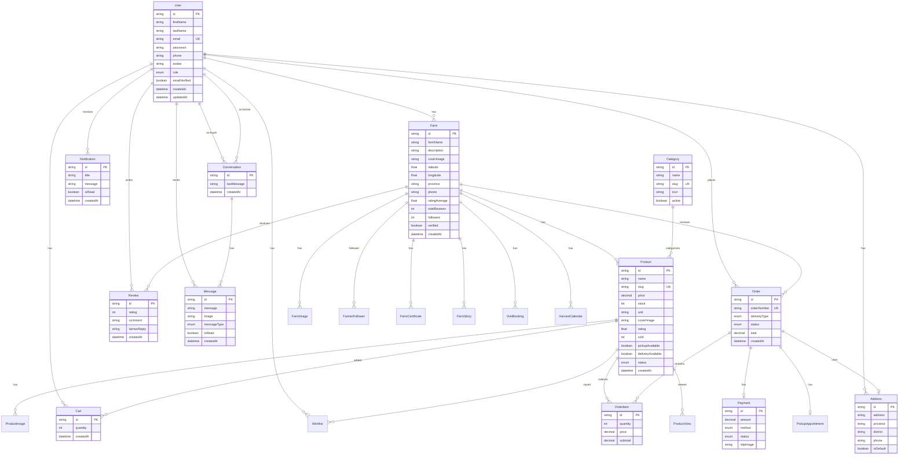

# FarmConnect Database Diagram

## Relationships Summary

| Model | Relations |
|-------|-----------|
| **User** | farms, orders, reviews, cart, wishlist, messages, notifications, addresses |
| **Farm** | products, farmImages, reviews, orders, followers, certificates |
| **Product** | images, cartItems, wishlistItems, orderItems, views |
| **Order** | items, payment, pickupAppointment, address |
| **Conversation** | messages, buyer (User), farmer (User) |
| **Review** | buyer (User), farm (Farm), product (Product) |

> เปิดไฟล์นี้ใน VSCode แล้วใช้ extension **Markdown Preview Mermaid Support** เพื่อดู diagram
> หรือ copy ไปที่ https://mermaid.live/edit